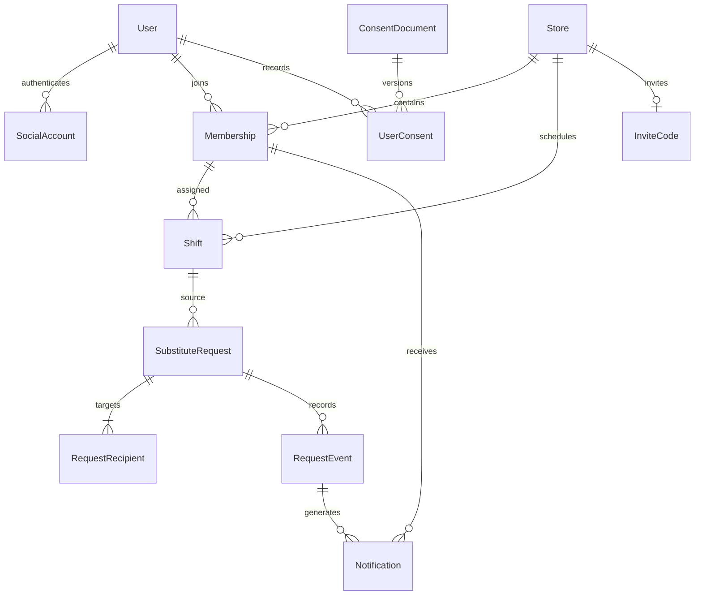

# 05 · 데이터·ERD 설계 초안

# BATON 데이터·ERD 설계 초안

기준일  · v3.0

정책서 v2.0과 기능명세서 v3.2를 구현하기 위한 논리 모델 초안이다. 아래 모델·필드·제약의 목적은 구체화했지만 DB 종류·타입·실제 DDL·마이그레이션은 백엔드 확인 전이다.

## 1. 데이터 구분

| 종류 | 보관 목적 | 범위 |
| --- | --- | --- |
| 회원·소속 | 로그인·가입 진행·매장 접근 권한 | 계정과 매장 소속은 별개. 로그아웃·나가기·계정 탈퇴도 별개. |
| 근무·대타 요청 | 편성 원본과 요청의 상태를 일관되게 관리 | 수락은 후보 확정, 승인만 담당자 변경. |
| 이벤트·알림 | 진행 과정과 수신자의 확인 상태 | 요청 이벤트는 상태 기록, 알림은 7일 확인 목록. |
| 보안 접속기록 | 법정 보안 관리 | 일반 서비스 기록과 별도 보관·접근 권한. |

## 2. 모델과 주요 필드

| 모델 | 주요 필드 후보 | 역할·제약 |
| --- | --- | --- |
| User | id, display\_name, onboarding\_stage, selected\_role, account\_state, created\_at | 소셜 인증 이후 가입 진행 단계와 이름을 보관. 이름 2\~15자. selected\_role만으로 매장 권한을 판정하지 않음. |
| SocialAccount | id, user\_id, provider, provider\_subject, created\_at | provider는 Google/Apple. 제공자+식별자는 중복 연결 방지. 다른 구성원 응답에 비공개. |
| ConsentDocument | id, kind, version, required, body\_reference, effective\_at | 미정 문서 종류·본문을 임의 예시로 확정하지 않음. 운영 동의 문서가 준비되면 버전 식별. |
| UserConsent | id, user\_id, document\_id, agreed, agreed\_at | 보기/닫기와 동의 저장을 구분. 어떤 문서 버전에 동의했는지 재현. |
| Store | id, name, timezone, state, created\_by, created\_at | 매장명 1\~15자. 매장 시각 Asia/Seoul. 마지막 매니저 소속 해제를 자동 폐쇄·위임으로 구현하지 않음. |
| Membership | id, store\_id, user\_id, role, state, personal\_color, joined\_at, left\_at | 현재 소속과 권한의 기준. role은 MANAGER/CREW. 과거 소속·재참여 이력을 계정 재가입과 혼동하지 않음. |
| InviteCode | store\_id, code, created\_at, invalidated\_at | 매장 공통 8자리 한 개, 매장 종료 전 유효. 현재 코드 유일성. 재발급 UI·개인별 코드 없음. |
| Shift | id, store\_id, assignee\_membership\_id, starts\_at, ends\_at, version, deletion\_state | 근무 길이 0분 초과·24시간 미만. 익일 종료 보존. 정확히 동일한 유효 근무 중복 방지. 담당자 수정 API는 없고 승인에 따른 담당자 변경만 허용. |
| SubstituteRequest | id, store\_id, shift\_id, requester\_membership\_id, source\_version, source\_snapshot, candidate\_membership\_id, status, terminal\_reason, version, created\_at, closed\_at | 한 근무의 활성 요청 한 건. 스냅샷은 삭제된 근무의 마지막 정보 표시용이며 탈퇴 파기 대상에서 제외하지 않음. |
| RequestRecipient | request\_id, target\_membership\_id, response\_state, responded\_at, unavailable\_at | 본인·매니저 제외 같은 매장 크루원. 거절 후 유효 WAITING이면 재수락 가능. 떠난 미수락 대상은 응답 불가. |
| RequestEvent | id, request\_id, actor\_reference, event\_kind, before\_state, after\_state, occurred\_at | 요청·수락·거절·취소·철회·승인·종료의 진행 기록. 전체 이벤트를 회원 탈퇴 후 영구 보존한다는 뜻이 아님. |
| ShiftEvent | id, shift\_reference, event\_kind, before\_value, after\_value, actor\_reference, request\_reference, occurred\_at | 등록·삭제·승인에 따른 내부 처리 추적 초안. 근무 변경 이력 UI는 제공하지 않음. 근무 수정 이벤트는 이번 범위 없음. |
| Notification | id, store\_id, recipient\_membership\_id, request\_id, event\_id, kind, created\_at, read\_at, expires\_at | 생성 후 7일 만료. 이벤트+수신자 유일성. 요청 최신 상태는 별도 조회/결합하며 읽음으로 요청을 변경하지 않음. |
| IdempotencyRecord | scope, actor\_reference, client\_key, request\_fingerprint, operation\_state, result\_reference | 중복 제출의 같은 처리 결과를 재현하는 구현 후보. 보존·캐시 수명은 개발팀이 정하되 일반 회원정보 파기 정책을 우회하지 않음. |
| SecurityAccessLog | id, operator\_reference, operated\_at, source\_reference, operation\_kind, subject\_reference | 운영자 등의 개인정보처리시스템 접속기록. 일반 앱 요청·알림과 분리해 법정 보안기록 기준 적용. |

## 3. 관계

| 기준 모델 | 연결 | 관계 |
| --- | --- | --- |
| User | SocialAccount / Membership / UserConsent | 회원 한 명의 인증 연결·매장 소속·동의 기록. 소속 없는 계정도 가능. |
| Store | Membership / Shift / InviteCode | 매장 구성원·근무·공통 초대 코드. |
| Membership | Shift.assignee / Request.requester / Recipient.target / Request.candidate | 업무 관계를 이름 대신 소속 ID로 판정. |
| Shift | SubstituteRequest | 동일 근무에 과거 요청은 여러 건 가능하되 활성 요청은 한 건. 삭제 이후 상세를 위한 최소 스냅샷. |
| SubstituteRequest | RequestRecipient / RequestEvent / Notification | 대상 여러 명, 후보 최대 한 명. 이벤트와 알림은 별도. |
| RequestEvent | Notification | 같은 결과 이벤트의 수신자별 알림. 동일 사람 중복 생성 방지. |

자동 렌더링을 전제로 하지 않는 관계도 원본이다. 물리 삭제·익명화 시 nullable 관계는 실제 DB 설계에서 조정한다.

## 4. 키·조회 제약 후보

| 항목 | 키·조건 후보 | 보장할 결과 |
| --- | --- | --- |
| 인증 연결 | provider + provider\_subject | 같은 소셜 계정이 중복 회원으로 연결되는 문제 방지. |
| 현재 소속 | store\_id + user\_id + active 조건 | 같은 매장의 활성 소속 중복 방지. 계정당 다점포 기능을 새로 제공한다는 의미 아님. |
| 초대 코드 | code 전역 유일, store별 현재 코드 한 개 | 잘못된 매장으로 참여하지 않음. |
| 동일 근무 | store + 담당 소속 + 시작 + 종료 + 유효 근무 조건 | 완전 동일 중복 생성 방지. 삭제된 근무 재등록과 충돌하지 않도록 실제 인덱스 설계. |
| 활성 대타 | shift\_id + 상태가 WAITING/PENDING\_MANAGER인 조건 | 동시 요청 생성에서도 한 건 유지. |
| 요청 대상 | request\_id + target\_membership\_id | 동일 동료 중복 지정 방지. |
| 후보 획득 | request\_id의 단일 후보 + 상태/버전 조건 | 동시 수락 한 명만 성공. |
| 알림 중복 | event\_id + recipient\_membership\_id | 요청자/후보/매니저 역할이 겹쳐도 한 건. |
| 요청 목록 | 관계별 store/member + created\_at DESC + id DESC | 20개 커서 조회. |
| 알림 목록·만료 | recipient + created\_at DESC + id DESC / expires\_at | 7일 유효 범위·읽음 표시점·정리 작업. |

조건부 유일성·락·버전 비교의 실제 구현은 선택 DB에 맞춘다. 위 제약은 조회 후 검사만으로 끝내지 말고 동시 요청에서도 보장해야 한다.

## 5. 트랜잭션·동시성

| 처리 | 같이 일관되게 확정할 내용 | 검수 관점 |
| --- | --- | --- |
| 매장 생성·참여 | 매장/코드 검증 + 소속 생성 | 매장은 생겼는데 생성자 소속이 없는 상태·중복 가입 방지. |
| 최종 일괄 등록 | 서버 재계산 + 동일 중복 제외 + 모든 새 근무 저장 + 결과 | 미리보기 쓰기 없음, 최종 전부 성공/실패. |
| 첫 수락 | 상태·시각·원본·소속 검사 + 후보 획득 + 이벤트·수신 알림 | 후보 두 명·수락만으로 담당자 변경 방지. |
| 최종 승인 | 최신 요청/근무 잠금 또는 버전 비교 + 담당자 변경 + APPROVED + 이벤트·결과 알림 | 승인·취소·삭제·탈퇴 경합에서 부분 반영 방지. |
| 근무 삭제 | 선택 근무 삭제 + 활성 요청 종료 + 필요한 기록 | 삭제 후 오래된 요청 승인 불가. |
| 소속 해제·탈퇴 | 미종료 본인 배정 근무 검사 + 요청자/후보/대상 정리 + 권한 해제 + 수신자 재검증 | 먼저 소속만 지워 요청이 고아 상태가 되지 않음. |
| 알림 화면 진입 | 진입 스냅샷 확보 + 기존 7일 알림 읽음 + 첫 목록 반환 | 첫 20개만 읽고 나머지 미읽음을 남기는 구현 방지. 이후 새 알림은 미읽음. |

알림 저장이 같은 DB에 있으면 업무 상태와 함께 저장한다. 비동기 전달을 선택하면 outbox 등 재시도 가능한 방식으로 누락·중복을 막는다. outbox 도입 자체를 확정 기술로 강제하지 않는다. 앱 외부 푸시 발송은 추가하지 않는다.

## 6. 생명주기·파기

| 데이터 | 정책 | 설계 영향 |
| --- | --- | --- |
| Notification | 생성 후 7일 만료·자동 삭제 | 조회·표시점은 만료 시각부터 즉시 제외. 물리 정리 구현은 별도여도 만료 데이터 노출 금지. |
| Membership | 나가기는 계정 유지·소속 해제 | 이전 매장 권한 차단. 재참여는 새 유효 코드로 연결. |
| User·인증·동의 연결 | 계정 탈퇴 후 일반 개인정보 추가 보관 없음 | 토큰·식별자·직접 개인 연결 및 본인 수신 알림 파기. 동의 기록도 별도 법적 근거 없이 예외 처리하지 않음. |
| 근무·요청·이벤트 스냅샷 | 개인 이름·연결 정보 제거, 재식별 가능하면 해당 개인 관련 기록 삭제 | 단순 이름 마스킹이나 user\_id 해시만으로 완료 판단 금지. 다른 구성원의 기록에 불필요한 개인 정보가 남지 않게 정리. |
| SecurityAccessLog | 법정 보안기록 별도 보관 | 일반 서비스 데이터 삭제와 분리. 정책서 개인정보·법령 참조 적용. |
| 캐시·백업 | 파기와 복원 시 재유입 방지 | 삭제 대상 전파·복원 절차와 접근 권한을 운영 설계에 포함. |

## 7. 개발팀 확정 항목

| 항목 | 확인할 내용 | 결정값 |
| --- | --- | --- |
| DB·식별자·물리 스키마 | 필드 타입·유일 인덱스·참조 삭제 규칙·마이그레이션 |  |
| 동시성·멱등성 | 트랜잭션 격리·락/버전 비교·키 범위와 결과 재현 |  |
| 알림 진입 스냅샷 | 동일 시각 후발 알림까지 읽지 않도록 하는 워터마크 |  |
| 정리·파기 작업 | 만료 데이터 정리·재식별 점검·백업 복원 절차 |  |
| 월경계 야간 근무 조회 | 시작일 기준 노출을 기본 API 초안으로 검토. 다른 기준이면 클라이언트와 합의 |  |

위 표는 기술 계약 검토 항목이다. 제품 미정 3건과 구분하며 이미 확정된 알림·정렬·반복 기간을 다시 미정으로 돌리지 않는다.

## 관련 문서

[02 · 기능명세서](https://swyp7.atlassian.net/wiki/spaces/72/pages/7307311/02) · [03 · 서비스 정책](https://swyp7.atlassian.net/wiki/spaces/72/pages/7307266/03) · [06 · API 계약 초안](https://swyp7.atlassian.net/wiki/spaces/72/pages/6979587/06+API) · [07 · QA·인수 기준](https://swyp7.atlassian.net/wiki/spaces/72/pages/6881318/07+QA)
